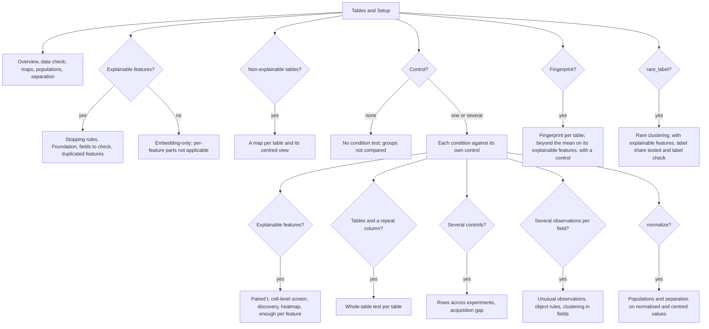

# What happens for what you provide

This page is the map from what you declare to what the report runs: which analyses each
input switches on, which values each analysis reads, how they are normalised, and which
tests give a verdict. It recaps the rules for each type of feature in one place; the
details of each analysis are on the page it links to. It describes the code as built
(`workflows.report` and the modules it calls).
[The scenarios](../../data/scenarios/README.md) run every path on a small dataset whose
answers are known.

## What you provide

**Feature tables.**

- The observation table's own numeric columns that you declare form an implicit
  explainable table ([data format](data_format.md)).
- Other tables come by name, each tagged: `feature_tables={"fiberfeatures": (fiber,
  "explainable"), "DINOv2": (dino, "non-explainable")}`, given to `report`, `html_report`,
  `scan_design` and `guide`. A bare DataFrame is non-explainable
  ([feature tables](../report/feature_tables_and_maps.md#explainable-and-non-explainable-tables)).
- Explainable only: a `readout`, no non-explainable table. Non-explainable only, the
  embedding-only report: `readout=None` and no `features`. A mix: both.
- With explainable tables and no `features`, every column of those tables is a feature;
  the `readout` must still be declared.

**What is read and what a row is.**

- `readout`: the one column the stopping rules, the Foundation, the object rules and the
  fields to check read.
- `features`: the explainable columns tested one by one with the readout. Novelty and
  unusual observations read `features`, the readout only when it is listed among them (the
  guided session always lists it); the populations, the maps and the separation read the
  readout and `features`.
- `observation_unit`: the word for a row, and the default rules: per object and per field
  for objects, cells and nuclei, per field only for any other unit.
- One observation per field is read from the data, not declared: the Foundation and the
  spread over fields are then not applicable, and unusual observations and the object rules
  are not run; nor are novelty and the positive control when a new state needs several
  similar observations in one field (the default definition of new). The report and the
  declaration say so, with this reason.

**The control.**

- None: `control=None`; comparisons then need explicitly requested contrasts, not yet
  supported by the report ([below](#d-no-control-declared)).
- One: `control={"condition": "MOCK"}`.
- Several: `control={"condition": {control: {treatment: condition} or [conditions]}}`, with
  `control_parents` and `master_control`; they generate the contrast table, or
  `contrasts=table` replaces it. One control written in these forms, without parents, is
  one control ([several controls](../report/conditions.md#several-controls)).
- A positive control: `positive=PositiveControl(...)`, which needs the control, `features`
  and `novelty`, and `fovs_seen` at least the definition of new's `min_fovs`.
- Several controls with no condition under any of them and no parent compare nothing with
  its own control: the Setup refuses them, naming what to declare, and the guided session
  asks again. `scan_design` takes the several-controls form as the Setup does.

**Normalisation.** `normalize="control_mean"` needs a control named by condition. It divides
the explainable features and centres the non-explainable tables, both described
[below](#normalisation-in-one-place). An embedding-only Setup accepts it too and then only
centres the tables. `intensity_features`, with several controls, names columns to compare
between the controls besides every declared column whose name contains "intensity".

**Scale.** `scales={"area": "ratio", "velocity": "difference"}` declares the scale of a
feature's tests across repeats; a feature not named keeps the automatic rule, the log ratio
when every observation is positive, else the difference, which the test description says
once. A declared ratio on a feature with a value that is not positive is refused
([setup](setup.md#the-setup); plan v2, owner, 2026-10-06).

**Targets** ([what the acquisition must preserve](setup.md#what-must-the-acquisition-preserve)).

- `tolerances`, default 5% and 2.5%: the readout's mean, always declared with a readout.
- `fingerprint=(OutcomeCriterion(...), ...)`: on explainable features or on one table's
  columns, which the Setup must name.
- `rare=RareTarget(...)` and `rare_label`, a 0/1 or boolean column; without the label the
  target is stated and planned for, not judged.
- In the guided session, the aim sets the fingerprint: "averages" declares none; "the whole
  distribution" or "both" declares a covariance criterion on the features and one per table
  at one tolerance, and the default definition of new on the features. A covariance
  criterion is named the **covariance fingerprint** in the report, the page and the guided
  session, since a covariance is not the whole distribution; any other criterion stays "the
  fingerprint" (plan v2, owner, 2026-10-06). "The whole
  distribution" declares no mean target (`tolerances=()`), so no mean-precision rule, and
  the declaration says so once; "averages" and "both" keep the mean target (owner,
  2026-10-06). Without explainable features the aims are the whole distribution, the
  labelled phenotype, or both.

**Repeats and wells.**

- `biological_repeat`: the replicate of every verdict; paired tests need 3 repeats.
- `technical_repeat`, the wells: part of each analysis group by default, and the unit
  resampled or shuffled first wherever one is.
- `fields_independent=True`: without a well column, the tests within one repeat and the
  feature ranking shuffle whole fields.

## The decision tree

Maps need 3 columns in a space, populations 2, the separation 2 conditions and a space with
a map; the object rules need a readout; the label check runs when no positive control is
declared and there are explainable features.

## Per feature type

A sub-experiment is a set of conditions linked by the biological repeats they share with
their control (`sampling_unit._experiments`). "Own control" is the condition's control in
the contrast table, or the one control.

### Explainable features

| Analysis | Values it reads | Level | Correction family | Not run, or not applicable, when |
| --- | --- | --- | --- | --- |
| Paired t across repeats, the main rows | raw means per repeat; tested on the scale declared in `Setup(scales=...)` (plan v2, owner, 2026-10-06), else on the log ratio to the own control when every observation of the feature is positive, else the difference, one scale per feature for every condition (owner, 2026-10-06); raw beside | biological repeat | Benjamini-Hochberg over every explainable feature, the label share and every main row, per sub-experiment | fewer than 3 repeats: direction and d only; no repeat holds both: "Not compared" |
| `across_normalised` rows | per repeat, each condition's log ratio to its own control, their difference | repeats holding all four | one family over every feature and row of this kind | fewer than 3 repeats: named, not compared; no treatment key: no row |
| `vs_master_raw` rows | per repeat, the raw difference of a control and the master | repeats holding both | one family over every feature and row of this kind | no master; a pair joined by a parent link |
| Cell-level screen | observations pooled over repeats, divided by the same repeat's control mean when every control mean is positive; balanced when the repeats are unbalanced | observation | the same family as the paired t | the control pooled from other repeats with no balanced test possible |
| Discovery and ranking | the screen as the gate, the paired t as the second gate, ranked by the largest \|d\| | as above | as above | fewer than 2 compared columns, the readout and the label share counted |
| Ranking within repeats | field means within each repeat | wells, or fields with `fields_independent` | one family over all its tests | no well and fields not declared independent: no test |
| Heatmap | the discovery's d and q | observation, repeat | the discovery's | no discovery |
| SuperPlots and pairwise panels | divided by the own control with `normalize`, else raw; pairwise d with 1999 shuffles | points per observation, intervals over wells and fields | the pairs of one figure | normalised: pairs under different controls are not compared |
| "Did I image enough?" per feature | per repeat, the bootstrap interval of d over wells then fields; the mean-precision rules on raw values | repeat and condition; each analysis group | none | fewer than 2 explainable columns: the readout's answer only; no control |
| Mean-precision stopping rules | the raw readout, upper 95% bound at the first tolerance | analysis group, per object and per field | none | no readout |
| Fingerprint | as declared, or on the first k principal components when wider than a fifth of the median judged group; divided by the own control with `normalize`, whatever the number of controls | analysis group of at least 4 fields | none | groups of fewer than 4 fields: not judged; on components, groups of fewer than 5 k observations: not assessable, named |
| Beyond the mean | the explainable features the fingerprint reads, per repeat against the own control on field-balanced subsamples (owner, 2026-10-06): SD ratio, 10%, 50% and 90% quantile shifts | biological repeat | its own family per sub-experiment | no fingerprint; a fingerprint reading no explainable feature, said once; no control |
| Rare label | its share compared like a feature; the label check on the nearest cell of another field; clustering in fields | observation, field | the features' family; clustering over groups and states | label check with a positive control declared; without explainable features, clustering only; one observation per field: no clustering in question 3, the one-per-field reason instead (owner, 2026-10-06) |
| Populations | the readout and `features` as the figures read them, MFA across two or more explainable tables | observation; enrichment per repeat | groups and conditions per sub-experiment | fewer than 2 columns; enrichment without a control or with fewer than 3 repeats |
| Unusual observations | the declared `features` raw, MFA across tables, against each own control | observation; clustering per field | groups and states | no control, no `features`, one observation per field |
| Novelty and the positive control | the declared `features` raw, MFA across tables, fitted on the visible fields | field | none | no `novelty`; one observation per field when a new state needs several in one field |
| Maps PCA and UMAP | raw, and divided by the own control whenever a control is declared; robustly standardised | observation | none | fewer than 3 columns in the space |
| Separation scores | by condition as the figures read them; by repeat always raw; one line with one well per condition and repeat, no within-repeat technical replication | neighbours outside the field, per repeat | none, descriptive | one condition; a space of fewer than 3 columns, which has no map |
| Copy checks | each explainable table apart, or the features as one table | field | none, exact | `integrity=True` not given; the guided session gives it |
| Duplicated or derived features | every declared column, on all rows and within each experiment | column pair | none, a caution | none |
| Acquisition gap | raw medians of intensity columns of each pair of controls | control | none, a caution at a 2-fold gap, an engineering threshold for quality control, not a test | one control |
| `optimise` | criteria on held-back fields, divided as the fingerprint, a fingerprint's components refitted on the fields not held back; the rules replayed raw | analysis group | none | no target it can judge |
| `live_session` | the raw columns of each field | analysis group | none | none |

With the readout as the only explainable column, its own tests are corrected over its
conditions per sub-experiment. With no `features` and other tables given, unusual
observations read the readout alone, as the declaration and the report say (owner,
2026-10-06, audit 8).

### Non-explainable tables

| Analysis | Values it reads | Level | Correction family | Not run, or not applicable, when |
| --- | --- | --- | --- | --- |
| Per-feature tests, heatmap, SuperPlots, "enough" per feature | never | | | always |
| Whole-table test, the verdict | raw columns robustly scaled per comparison on its two sides' within-group residuals (owner, 2026-10-06), field means, the shift per repeat projected on the other repeats' mean shift | biological repeat | per table and sub-experiment, apart from the features | no control or no repeat column; fewer than 3 repeats: "not tested"; rows across experiments are not tested |
| Whole-table shuffle | the same centres, labels of units shuffled within repeats, 999 times | wells, else the group columns beyond condition and repeat, else fields | none, in `tests_whole_table.csv` only | fewer than 40 distinct assignments |
| Mean-precision rules | none | | | always |
| Fingerprint per table | raw columns robustly standardised, the first k principal components fitted on every complete observation | analysis group of at least 4 fields | none | one k, a fifth of the median judged group; a group of fewer than 5 k observations not assessable, named; k under 2 or no group of 4 fields: not assessable, `optimise` too |
| Populations | each table apart and the combined space, at most 5,000 observations each; raw, centred per repeat with `normalize` | observation | merged with the explainable groups, one family | fewer than 2 columns |
| Unusual observations | only when no `features` are declared: in an embedding-only report the tables' MFA space, centred with `normalize`; with a readout, the readout alone | observation | groups and states | `features` declared; no control; one observation per field |
| Novelty and the positive control | never | | | always |
| Maps | one per table and a combined MFA map; a centred view per table | observation | none | fewer than 3 columns |
| Separation scores | each table and the combined space; by condition raw, centred with `normalize`; by repeat always raw | neighbours outside the field | none | one condition; fewer than 3 columns |
| Copy checks | each table apart, the union named by table | field | none | `integrity=True` not given |
| Duplicated features, acquisition gap | never | | | always |
| `optimise` | the fingerprint on the same components, on held-back fields | analysis group | none | no fingerprint and no labelled phenotype |
| `live_session` | the columns sent with each field | analysis group | none | no `rules` in an embedding-only Setup |

The whole-table headline names a condition shifted the same way in every repeat as a trend
when no shift is significant, from 6 repeats only, as the per-feature "same direction in
every repeat, not significant" (owner, 2026-10-06): with fewer, every repeat goes the same
way without an effect too often, with the exact chance `2^(1-n)` for a feature's `n`
independent repeats (25% with 3, 12.5% with 4, 3.1% with 6; plan v2, owner, 2026-10-06). The test, its calibration and its words are in
[the whole-table test](../report/conditions.md#the-whole-table-test-other-feature-tables);
the spaces and the centred view in
[feature tables and maps](../report/feature_tables_and_maps.md).

## Normalisation in one place

**Control normalisation.** Each explainable feature is divided by the mean of the control's
observations in the same biological repeat; the control's own values too, so they average 1.
With several controls each condition is divided by its own control, a control by its
parent, else by itself; a condition held in a repeat without its own control is missing
there and named once. With one control a repeat without control observations, or a control
mean that is zero, negative or undefined, stops the report. What reads these values is
listed once, in `_contrasts.normalised_readers`, which the overview and the declaration
print: with `normalize`, the figures, the normalised maps, the populations, the separation
scores, the fingerprint and `optimise`'s criteria, whatever the number of controls (owner,
2026-10-06, audit 8). The maps show
them whenever a control is declared. The tests read raw values and normalise each
comparison to its own control themselves; the stopping rules, the fields to check, unusual
observations, novelty, the Foundation and the live session read raw values. The rules are
in [normalising to the control](setup.md#normalising-to-the-control).

**Batch centring of the non-explainable tables.** A table is never divided. Each column
is centred per biological repeat on the median of the per-condition medians of the
conditions in every repeat, balanced or not (owner, 2026-10-06, audit 8); without such a
condition, within each sub-experiment on the conditions in all of its repeats, a
sub-experiment with none left out of the centred values and named (raw values in a centred
space would read as a batch; with no centre at all, the tables are read as given). One line
says which conditions set the centre. The centred map view is shown whenever there is a
centre. With `normalize` the
populations and the separation of the conditions read the centred values, and so do unusual
observations in an embedding-only report. No test reads them: the whole-table test and the
fingerprint read raw values. The rule and why are in
[batch normalisation](../report/feature_tables_and_maps.md).

**Robust standardisation and MFA weighting.** Before distances or principal components, each
column is centred on its median and divided by its MAD as an SD, or by its SD when the MAD
is under a quarter of it: the maps, the populations, the separation, the label check and a
wide fingerprint read this; the whole-table test divides by the same robust scale, taken per
comparison on the within-group residuals of its two sides (owner, 2026-10-06). Novelty uses its own transform,
`RobustStandardize` by default, and unusual observations a mean and SD fitted on the
reference. MFA weighting divides each table by its first singular value over `sqrt(n - 1)`,
so every table's first axis has variance 1 whatever the order of the tables and a wide or
correlated table does not outweigh another (owner, 2026-10-06, audit 8; with one table
nothing is weighted): the explainable tables among themselves when there are two or more,
for novelty, unusual observations, the populations and the label check; every table in the
combined space of the maps, the populations and the separation. Novelty's radius `sqrt(d)`
then reads as the square root of the weighted space's total inertia. It changes no statistic
of the whole-table test.

**The centred map view.** Beside each non-explainable table's raw map, its map on the
centred values above. With `normalize` the combined map's normalised view reads the
normalised explainable features and the centred tables, the space the populations search;
without explainable features the combined map has a centred view instead (owner,
2026-10-06, audit 8).

## Testing in one place

| Test | Unit of replication | Benjamini-Hochberg family | Role |
| --- | --- | --- | --- |
| Paired t on repeat means, main rows | biological repeat, from 3 | every explainable feature, the label share and every main row, per sub-experiment | the verdict, "significant across repeats"; with exactly 3 repeats, each repeat's change and the 95% t interval beside it, "very limited biological replication" said once (plan v2, owner, 2026-10-06) |
| Sign-flip test | biological repeat | the readout's conditions per sub-experiment | in the full report, only where its smallest p can reach 0.05 |
| `across_normalised`, `vs_master_raw` | biological repeat, from 3 | one family per kind over every feature and row | verdicts across experiments |
| Whole-table test | biological repeat, from 3 | per table and sub-experiment | the verdict for a table |
| Beyond the mean | biological repeat | per sub-experiment, its own family | exploratory: on the distribution |
| Population enrichment | biological repeat, from 3 | groups and conditions per sub-experiment | exploratory: on a group's share |
| Cell-level screen | observation | the paired t's family | exploratory: candidates |
| Within one repeat | wells, or fields with `fields_independent` | Bonferroni over the comparisons | descriptive, run only when it can reach 0.05 |
| Ranking within repeats | wells, or fields | all its tests together | which features to plot |
| Pairwise panels | observation | the pairs of one figure | descriptive |
| Whole-table shuffle | wells, else fields | none | exploratory, CSV only |
| Clustering in fields | field | groups and states | a state called clustered at q 0.05 or less |
| Acquisition order | field | Bonferroni over its two tests | a caution beside a stop, never a veto |

Exploratory until their module of [the validation protocol](validation.md) validates them
(plan v2, owner, 2026-10-06): population enrichment, beyond the mean, the covariance
fingerprint, the rare target and novelty. Each section of the report and of the page that
answers with one of them says so once, in one sentence pointing to that protocol
(`workflows._exploratory`).

Benjamini-Hochberg controls the false discovery rate within each family above, never across
the report: a report of several families can hold more false discoveries overall than any
one family allows. The report says so once, where it explains its q-values (plan v2, owner,
2026-10-06).

Descriptive, with no p-value: Cohen's d per repeat, the separation scores, the populations
and their rules, unusual observations, novelty and the positive control, the label check,
the bimodality line, reagent agreement, the copy and duplicated-feature checks and the
acquisition gap. The tests and their assumptions are in
[Do the conditions differ?](../report/conditions.md).

## Four worked paths

**(a) Explainable features, one control, normalised.** `Setup(readout="area",
features=(...), control={"condition": "ctrl"}, normalize="control_mean")`.

- The overview, the duplicated-feature check, the Foundation, the object rules, the
  stopping rules and the fields to check.
- Per feature: the paired t on log ratios, the cell-level screen, the discovery, the
  heatmap and the SuperPlots of normalised values, in one family per sub-experiment.
- "Did I image enough?" per feature and the mean-precision rules on the raw readout.
- Unusual observations and their clustering on the raw `features`, against the control.
- The maps raw and normalised, the populations and the separation on normalised values.
- No whole-table test, no rows across experiments.

**(b) Embedding only, one control, fingerprint aim.** `Setup(control={"condition": "ctrl"},
fingerprint=(...), feature_tables={"DINO": columns})`, with `feature_tables={"DINO": dino}`
given to `report`.

- The whole-table test is the only test of "Do the conditions differ?".
- The fingerprint of DINO on its first k principal components, per analysis group.
- Unusual observations on the DINO columns, when a field holds several observations.
- The DINO map with its centred view, the populations, which have no rule, and the
  separation.
- The Foundation, question 1, the fields to check, everything per feature and the
  mean-precision rules: not applicable. `optimise` judges the fingerprint; `live_session`
  needs `rules`.

**(c) A mix, several controls with a master.** Two explainable tables, one DINO table,
`control={"condition": {...}}`, `master_control=...`, `normalize="control_mean"`.

- The features of the observation table and both explainable tables: one family per
  sub-experiment, each result row naming its table.
- The rows across experiments, two families over every feature; the acquisition gap on
  intensity columns and the duplicated features within each experiment.
- The whole-table test of DINO on the main rows only.
- Unusual observations, the explainable populations and novelty when declared weigh the
  two explainable tables by MFA; unusual observations against each own control, the object rules and
  clustering against the controls pooled.
- Maps: combined, explainable, each explainable table of 3 columns or more and DINO, with
  DINO's centred view.
- The populations in the explainable, DINO and combined spaces, on values normalised to
  each own control and centred, so observations in repeats without their own control are
  left out of the spaces holding the explainable features, and named once ("36 cells of b1
  and b2 in R4 left out: no own control"), never counted as missing values.

**(d) No control declared.**

- The overview, the Foundation's variability, the stopping rules, the fields to check, the
  next-field novelty with `novelty`, and the targets.
- The maps raw, each table's centred view, the populations without enrichment, and the
  separation.
- No condition test, no whole-table test, no unusual observations, no normalisation: a
  Setup with `normalize` and no control is refused.
- "Do the conditions differ?" reads, once: "not applicable: no control is declared:
  comparisons are available only for explicitly requested contrasts estimable from the
  repeat design, which the report does not support yet" (plan v2, owner, 2026-10-06; before,
  "described, not tested"): two conditions in shared repeats are a legitimate direct
  contrast, which the contrast layer will estimate once validated (module P2 of the
  [validation protocol](validation.md)); the guided session says the same sentence.
